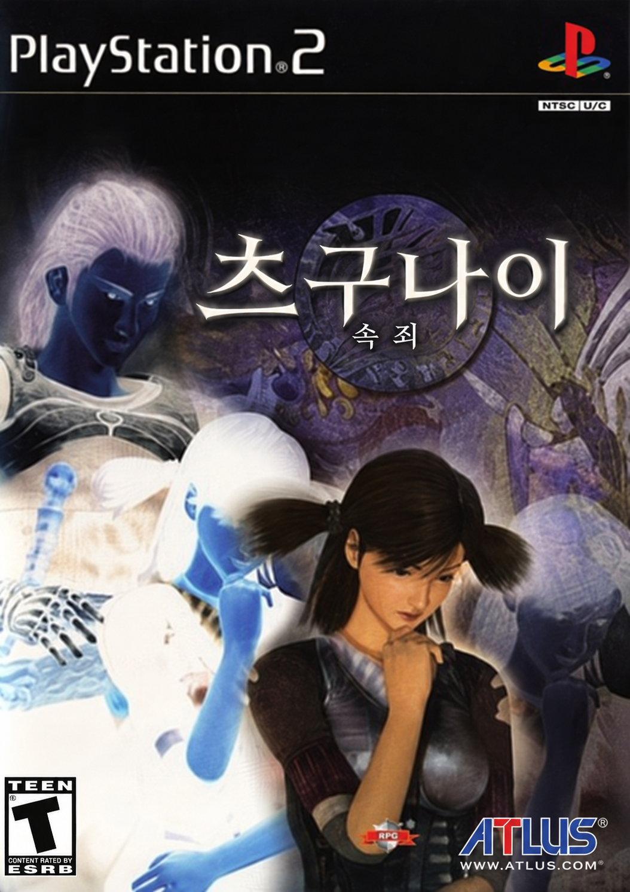

<p align="center"></p>

# 츠구나이: 속죄 한글패치 (つぐない Korean Patch)

PS2 일본판 **つぐない (SCPS-11007)** 를 한국어로 옮기는 팬 번역 프로젝트입니다.
게임 이미지를 직접 고치지 않고, 원본 디스크 이미지에서 매번 같은 결과를 만들어 내는 빌드 스크립트와 번역 데이터를 관리합니다.

> **현재 상태: 기술 조사·PoC 단계.** 아직 배포할 패치는 없습니다.

## 진행 상황 (2026-11-13)

| 영역 | 상태 |
|---|---|
| 초기 조사 | 끝 — 파일 테이블, 압축, 폰트, 스크립트 구조 해석 (`docs/survey.md`) |
| 기술 PoC | PoC1 한글 글리프 표시, PoC2 대사 길이 변경, PoC3 줄 폭 상한, PoC4 데이터 파일·실행 파일 문자열 수정 — PCSX2에서 통과(PoC4 전투 화면 항목은 미확인) (`docs/poc.md`) |
| 텍스트 추출 | 대사 스크립트 44,290행(고유 약 17만 자), 데이터 파일 7종 804행(약 7천 자), 실행 파일 화면용 293행(약 2,160자) 추출 완료 (`docs/text_map.md`) |
| 그림 글자 | 대상 확정: 타이틀 로고, 퀘스트 제목 카드 35장, 스태프롤, 메뉴·전투 UI 텍스처 (`docs/graphics_text.md`) |
| 번역 | 용어집 초안 474항목(인물·지명·몬스터·아이템·기술·마법·퀘스트 제목, `text/glossary.jsonl`). 대사 번역: MQ00·MQ21–MQ25 29,123줄 검수 반영(전체 44,290줄 중), 나머지 진행 중 (`text/ko/`, 말투 `docs/voice.md`) |
| 배포 | 시작 전 |

### 남은 큰 작업

1. 대사 번역·검수 (번역·검수 모두 Claude, `docs/decisions.md` D1). 용어집 2차 검수 포함
2. 한글 이름 입력과 주인공 이름 뒤 조사 처리
3. 그림 글자 다시 그리기
4. 배포용 xdelta 패치와 적용 스크립트, 엔딩까지 실행 확인

## 지원 원본

일본판 **SCPS-11007** 한 가지만 지원합니다. CD 이미지(MODE2/2352, 단일 트랙)입니다.

```
72f131160b40ff309ebf06ac501bf65971da4da6  Tsugunai (Japan).bin
```

북미판 *Tsugunai: Atonement* 는 지원하지 않습니다. 고유명사 표기를 참고하는 데만 씁니다(D2).

## 저장소 구성

```
tools/      빌드·분석 도구 (Python)
  sl00.py       게임 자체 압축(SL00) 코덱
  cdimage.py    MODE2/2352 섹터 EDC/ECC, ISO9660 목록, FILEZ.DAT(게임 파일 테이블)
  discbuild.py  파일 교체·재배치 디스크 빌더 (계획 밖 섹터 변경 시 실패)
  font.py       FONT.BIN(22×22 4bpp) 코덱과 한글 글리프 렌더링
  scp.py        대사 스크립트 파서·재배치 직렬화기
  scp_text.py   대사 추출·적용
  textcodec.py  원문 바이트 ↔ 토큰 문자열({c:xx} 색, {n:xx} 이름)
  datafile.py   아이템·무기·호부·마법·퀘스트 기록·몬스터 데이터 파일 코덱
  data_text.py  데이터 파일 텍스트 추출·적용
  elfrefs.py    실행 파일 주소 참조 탐지·수정(MIPS)
  elf_text.py   실행 파일 텍스트 추출·적용(제자리/재배치)
  glossary.py   용어집 형식 검사·원문 근거 확인
  translation.py 번역 파일 검사(보호 원문·토큰·조사 토큰·줄 폭·반각 금지)
  batch.py      번역 배치 생성·검사·병합, 검수 수정 적용
  psi.py        PSI 이미지 코덱
  build_poc*.py PoC 이미지 빌드
  run.sh, xinput.py  PCSX2 가상 디스플레이 실행·입력·스크린샷
tests/      pytest 테스트
text/       추출한 원문(scp_src.jsonl, data_src.jsonl, elf_src.jsonl), 용어집(glossary.jsonl), 앞으로의 번역 데이터
docs/       조사·결정·PoC 기록
orig/       원본 이미지 심볼릭 링크 (저장소에 포함하지 않음)
```

## 개발 환경

- Python 3.11, Pillow, capstone, pytest
- PCSX2 2.8.2 (flatpak) — 프로젝트 폴더 접근 허용 필요:
  `flatpak override --user --filesystem=<프로젝트 경로> net.pcsx2.PCSX2`
- 원본 이미지를 `orig/tsugunai.bin`(와 `.cue`)으로 링크합니다.

```bash
python -m pytest -q tests                                   # 테스트
python -m tools.scp_text work/ex text/scp_src.jsonl         # 대사 추출 (work/ex = 디스크에서 꺼낸 파일)
python -m tools.glossary text/glossary.jsonl text/*_src.jsonl  # 용어집 검사
python -m tools.translation text/ko text/scp_src.jsonl text/glossary.jsonl  # 번역 검사
python -m tools.build_poc1 orig/tsugunai.bin build/poc1.bin # PoC 이미지 빌드
tools/run.sh build/poc1.bin                                 # PCSX2로 실행
```

## 알아 둘 점

- 원본 게임 이미지와 그 파일은 저장소에 넣지 않습니다. 패치를 쓰려면 정품 디스크에서 직접 만든 이미지가 필요합니다.
- 비공식 팬 번역입니다. 원작의 권리는 Sony Computer Entertainment와 Cattle Call에 있습니다.
